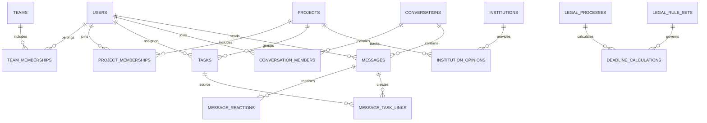

# ENCEV PULSE — Mantıksal Veritabanı Tasarımı

**Durum:** Kimlik/oturum, temel proje/görev ve görev atama bildirimi için `drizzle/0001_authentication.sql`, `drizzle/0002_tasks_and_projects.sql` ve `drizzle/0003_notifications.sql` migration'ları yerel geliştirme veritabanına uygulanmıştır; kalan ürün tabloları mantıksal tasarım önerisidir.
**Tarih:** 3 Kasım 2026  
**Güvenlik:** Bu tasarım şirket dosya sunucusuna bağlanmaz; gerçek dosyaları okumaz veya kopyalamaz.

## 1. Tasarım ilkeleri

- PostgreSQL ana ve kalıcı kayıt kaynağıdır. Tarayıcı veritabanına doğrudan bağlanmaz; API kimlik, yetki ve iş kurallarını uygular.
- Görev, proje, konuşma, mesaj ve yasal süreç ilişkileri foreign key ve transaction ile korunur.
- Her kayıt için UUID tabanlı kimlik, UTC saklanan `timestamptz` zamanları ve açık durum sözlüğü önerilir. Kullanıcı arayüzünde saatler kurumun belirleyeceği saat diliminde gösterilir.
- Silme yerine arşivleme/iptal tercih edilir; yasal veya operasyonel saklama gereksinimleri netleşmeden fiziksel silme politikası belirlenmez.
- Kritik değişiklikler aktör, zaman, hedef ve işlem türüyle audit edilir. Audit kaydı parola, token veya gereksiz mesaj/dosya içeriği taşımaz.
- Büyük kayıt kümeleri cursor/keyset pagination ile okunur; sınırsız liste uçları olmaz.
- PostgreSQL Row Level Security (RLS) ek savunma katmanı olabilir. Tablo sahibi, superuser ve `BYPASSRLS` rolüyle ilgili istisnalar bulunduğundan RLS, API yetki kontrolünün yerine geçmez. [PostgreSQL Row Security](https://www.postgresql.org/docs/18/ddl-rowsecurity.html)

## 2. Önerilen varlık grupları

### Kimlik, ekip ve erişim

| Varlık | Temel alanlar / ilişkiler | Not |
|---|---|---|
| `users` | id, username, email, display_name, password_hash, status, must_change_password, password_expires_at, created_by, created_at, updated_at | İlk sürümde yerel hesap. `username` ve kurumsal e-posta kanonik küçük harf biçiminde saklanır; iki alan da benzersizdir. Çalışan profili Kurum Rehberi'ne kopyalanmaz. |
| `external_identities` | id, user_id, provider, issuer, tenant_id, subject, created_at, linked_by | Gelecekte Entra ID/SSO bağlantısı için ayrılmış ilişki; e-posta eşitliği otomatik hesap birleştirme yapmaz. Şu an OIDC etkin değildir. |
| `auth_sessions` | id, user_id, session_token_hash, csrf_token_hash, created_at, last_seen_at, idle_expires_at, expires_at, revoked_at | Yalnız backend erişir; cookie'deki opaque token'ın hash'i tutulur. Ham session veya CSRF token DB'ye yazılmaz. |
| `auth_csrf_challenges` | id, challenge_hash, origin, created_at, expires_at, consumed_at | Giriş öncesi tek kullanımlı CSRF challenge; kullanımdan ve kısa süre sonunda temizlemeden önce artık kabul edilmez. |
| `auth_rate_limit_buckets` | dimension_hash, window_started_at, attempt_count, blocked_until, updated_at | Normalize kimlik ve istemci IP boyutları için atomik rate-limit sayaçları; ham kullanıcı adı/e-posta/IP yerine anahtar hash'i saklanır. |
| `auth_bootstrap_state` | singleton_key, completed_at, completed_by | Bir defalık ilk yönetici kurulumunu transaction ve kilit altında kapatır; varsayılan admin/parola içermez. |
| `auth_audit_events` | id, actor_user_id, target_user_id, action, occurred_at, request_id, details | Hesap oluşturma/devre dışı bırakma ve parola işlemlerini içerik veya parola olmadan eklemeli kaydeder; tablo trigger'ı UPDATE/DELETE'i reddeder. |
| `teams` | id, name, status | Kurum içi ekip/çalışma grubu. |
| `team_memberships` | team_id, user_id, role, valid_from, valid_to | Geçmiş üyelik gerektiğinde tutulur; aktif üyelik tekil kısıtla korunur. |
| `roles`, `permissions`, `role_permissions` | kod, açıklama ve ilişki | Sistem rolü ve izin kataloğu. |
| `user_role_assignments` | user_id, role_id, assignment metadata | Yalnız şirket genelindeki atamalar. Ekip/proje atamaları aşağıdaki tipli tablolardadır. |
| `team_role_assignments` | team_id, user_id, role_id | Her ilişki gerçek FK ile korunur. |
| `project_role_assignments` | project_id, user_id, role_id | Her ilişki gerçek FK ile korunur. |

### Proje ve görev

| Varlık | Temel alanlar / ilişkiler | Not |
|---|---|---|
| `projects` | id, name, description, status, created_by, owner_user_id, starts_on, target_on, version, status_before_archive, created_at, updated_at, archived_at | `0005_project_workflow.sql` ile proje sahibi, başlangıç/hedef tarihleri, yaşam döngüsü ve sürüm kontrolü uygulandı; arşiv önceki durumu saklar. |
| `project_members` | project_id, user_id, added_by, added_at | Üyelik bileşik primary key ile tektir; proje görevi görünürlüğü üyelikten gelir. Proje sahibi üyeliği zorunludur; sahip/oluşturan proje yönetebilir, üye proje bağlamını okuyabilir. |
| `project_audit_events` | id, project_id, actor_user_id, event_type, details, created_at | Proje oluşturma, güncelleme, üye değişikliği ve arşiv/geri yükleme olayları append-only trigger ile korunur; event metadata'sı proje içeriğini veya sırları kopyalamaz. |
| `tasks` | id, project_id nullable, title, description, status, priority, created_by, assignee_id, starts_on, due_on, archived_at, position, version | Proje dışı kişisel görev desteklenir. `version` eşzamanlı düzenleme çakışmasını yakalar. |
| `task_audit_events` | id, task_id, actor_user_id, action, changes, occurred_at | Temel görev oluşturma/değişiklik/arşiv olayları eklemelidir; içerik değerleri değil değişen alan adları saklanır. UPDATE/DELETE trigger ile reddedilir. |
| `notifications` | id, recipient_user_id, actor_user_id, task_id, event_type, idempotency_key, created_at, read_at | Görev atama ve görev yorumu bildirimi; olay, görev/yorum transaction'ında oluşur. Alıcı, görev kapsamı kontrolünü geçmeden bildirim veya görev başlığını göremez. |
| `task_watchers` | task_id, user_id | Takipçi bildirimleri. |
| `task_comments` | id, task_id, author_user_id, body, version, created_at, updated_at, deleted_at | Mesajlardan ayrı, görev bağlamındaki yorum. Yalnız yazar kendi yorumunu düzenleyebilir/silebilir; silmede metin boşaltılır ve kayıt tombstone olarak kalır. |
| `task_comment_events` | id, task_id, comment_id, actor_user_id, event_type, details, occurred_at | Yorum oluşturma/düzenleme/silme metin içeriğini kaydetmeden eklemeli geçmiş olarak saklanır; UPDATE/DELETE reddedilir. |
| `task_status_events` | task_id, from_status, to_status, actor_id, occurred_at | Durum geçmişi ve raporlama. |

Görevlerde `(assignee_id, status, due_on)`, `(created_by, status, due_on)`, `(project_id, status, position)` ve `(user_id, project_id)` üyelik indeksleri kullanılır. Görev API'si sayfa başına en çok 200 satır ve 10.000'e kadar offset kabul eder; büyüyen veri kümelerinde kararlı keyset cursor'a geçilmelidir. Arşivlenmiş kayıtları liste dışına alan sorgular tüm ekranlarda tutarlı olmalıdır.

İlk görev erişim kuralı: kaydı oluşturan, atanan kullanıcı veya bağlı projenin üyesi görevi okuyabilir ve güncelleyebilir. Proje görevi oluşturulurken hem işlemi yapanın hem de atanan kullanıcının proje üyesi olması şarttır. Yetkisiz görev kimliği 404 döner. Her görev güncellemesi beklenen `version` değerini gönderir; sürüm uyuşmazlığı 409 döner. Oluşturma, alan değişikliği, arşivleme ve geri yükleme ile görev audit satırı tek transaction içinde yazılır.

Proje yaşam döngüsü için 0005 migration'ı uygulanmıştır. Proje listesi/detayı erişim kapsamına göre filtrelenir; sahip ve üyeler sunucu tarafında doğrulanır. Düzenleme, üyelik değişikliği ve arşiv işlemleri transaction ve `version` kontrolü ile yapılır; çakışma 409 döner. Proje audit olayları append-only saklanır.

Görev yorumları için 0004 migration'ı uygulanmıştır. Yorum okuma görevin mevcut erişim kuralını izler; yorum eklemek/düzenlemek/silmek için görev arşivlenmemiş olmalıdır. Düzenleme ve silme yalnız yorumu yazan kullanıcıya açıktır; sürüm alanı çakışmayı 409 ile bildirir. Yorum metni 4.000 karakterle sınırlandırılmıştır. Silme işlemi gövdeyi boşaltır, ancak yorum kaydı ve metin içermeyen olay geçmişi korunur. Yorum bildirimi aynı transaction içinde yalnız etkin ve göreve erişebilen diğer kullanıcılara yazılır.

### Sohbet

| Varlık | Temel alanlar / ilişkiler | Not |
|---|---|---|
| `conversations` | id, type, title, created_by, created_at, archived_at | Bire bir veya grup türleri; tür sözlüğü açık tanımlanır. |
| `conversation_members` | conversation_id, user_id, joined_at, left_at, role | Her okuma/yazma işleminde üyelik kontrolü. |
| `messages` | id, conversation_id, sender_id, client_request_id, body, created_at, edited_at, deleted_at, reply_to_id | Kalıcı mesaj. Idempotency anahtarı yinelenen gönderimi engeller. |
| `message_revisions` | message_id, editor_id, previous_body/reference, edited_at | Kurumun düzenleme ve denetim politikasına göre eski metin saklanır veya yalnızca metadata tutulur. Bu karar açık. |
| `message_reactions` | message_id, user_id, reaction_code, created_at | Mesaj/kullanıcı/tepki için tekil kısıt. |
| `conversation_read_cursors` | conversation_id, user_id, last_read_message_id, updated_at | Her mesaj için kişi başına okundu satırı yerine son görülen imleç. |
| `message_task_links` | message_id, task_id, created_by | Mesajdan oluşturulan görevin kaynağa çift yönlü bağlantısı. |
| `chat_attachments` | id, message_id, storage_provider, opaque_object_id, filename, detected_media_type, size, checksum, state, created_at | Dosya içeriği mesaj tablosunda tutulmaz. Depo NAS'tan bağımsız uygulama deposudur; üretim sağlayıcısı seçilmemiştir. |

Mesaj geçmişi `(conversation_id, created_at, id)` cursor indeksinden sayfalanır. Arama ilk sürümde PostgreSQL full-text search ile ölçülüp değerlendirilebilir; erişim kapsamı her sonuçta konuşma üyeliğiyle sınırlandırılır.

### Kurum dışı kayıtlar ve yasal süreçler

| Varlık | Temel alanlar / ilişkiler | Not |
|---|---|---|
| `institutions` | id, name, institution_type, status | Dış kurum/kuruluş rehberi. Çalışan profili içermez. |
| `institution_contacts` | institution_id, name, title, phone, email, valid_from/to | Kurumun iletişim kişileri; kişisel veri erişimi sınırlanır. |
| `institution_opinions` | id, project_id, institution_id, subject, received_at, status, owner_id | Kurum görüşü, sorumlu, durum ve proje bağlantısı. |
| `legal_processes` | id, process_type_id, project_id, institution_id nullable, status, opened_at, owner_id | Takvim/yasal süreç kaydı; process type FK. |
| `legal_process_types` | id, stable_code, owner_team_id | Tanımlı süreç türü; rule set serbest metin değil FK ile bağlanır. |
| `legal_rule_sets` | id, process_type_id, version, definition_schema_version, status, author_id, trigger_event_code, timezone, count_basis, duration, start_inclusion, weekend_policy, holiday_policy, last_day_policy, local_deadline_time, dst_resolution_policy, holiday_calendar_version_id, effective_from/to, definition_hash | Sürümlü, allowlist veri tanımı. Yalnız onaylı ve etkin sürüm otomatik hesaplama yapabilir. |
| `legal_rule_approvals` | rule_set_id, approver_id, approved_at, definition_hash, holiday_calendar_hash, approval_note | Onay hash'i değişmez kural ve tatil takvimine bağlanır; yazarın kendi kuralını onaylaması engellenir. |
| `holiday_calendar_versions` / `holiday_calendar_days` | calendar_id, version, status, content_hash, approved_by, approved_at, date, label, source | Tatil takvimi de sürümlenir; onay sonrası değiştirilemez ve hash ile hesapta sabitlenir. |
| `deadline_calculations` | process_id, rule_set_id/version, definition_hash, calendar_version_id/hash, inputs_snapshot, timezone, algorithm_version, trigger_at, due_at, calculated_at, supersedes_id | Hangi onaylı kuralla nasıl hesaplandığı doğrulanır; yeniden hesaplama yeni kayıt üretir, geçmiş kayıt ezilmez. |

Yasal süre motoru yalnızca allowlist enum ve sayısal alanlardan oluşan kural tanımını yorumlar; keyfî kod, ifade veya script çalıştırmaz. Tanım takvim/iş günü, tanımlı tetikleyici olay, başlangıç dahil-hariç, hafta sonu/tatil/son gün politikası, yerel bitiş saati, IANA saat dilimi ve belirsiz/var olmayan yerel saat için DST çözümünü içerir. Kural ve tatil takvimi şema sürümüyle kanonik biçimde serileştirilip SHA-256 gibi belirlenmiş hash yöntemiyle doğrulanır; onay hash'i birebir eşleşmelidir. Hesaplama girdisi, algoritma sürümü ve UTC `due_at` saklanır. Taslak/reddedilmiş/onayı bulunmayan kural otomatik son tarih üretemez. Kural değişikliği geçmiş hesapları sessizce ezmez; yeniden hesaplama farkı ve onay kaydı tutulur. Resmî tatil kaynağı ve yetkili kural onaylayıcısı henüz belirlenmemiştir.

### Dosya referansları, bildirim ve denetim

- `document_references`: sağlayıcı adı ve opak sağlayıcı nesne kimliği saklar; fiziksel yol/credential tutulmaz. İlişkiyi generic `entity_type/entity_id` ile kurmak yerine `task_document_links`, `project_document_links` gibi hedef bazlı ilişki tabloları gerçek FK taşır. Şirket dosya sistemi şimdilik aktif bağlantı değildir.
- `notifications`: recipient_id, event_type, task_id nullable, message_id nullable, project_id nullable, legal_process_id nullable, created_at, read_at, delivery_state. Her hedef alanı kendi tablosuna gerçek FK'dir; `CHECK` tam bir hedef FK'sinin dolu olmasını zorunlu kılar. Birden çok kayıt etkileniyorsa her hedef için ayrı notification yazılır. Başlık/özet API'de hedef yetkisi tekrar doğrulanarak üretilir.
- `notification_preferences`: kullanıcı, olay türü ve kanal tercihleri.
- `outbox_events`: business transaction içinde yazılan olay, event/idempotency anahtarı, deneme sayısı, lease ve sonraki deneme/işlenme zamanı. Gövdeye sır veya gereksiz kişisel içerik konmaz.
- `audit_events`: actor_id nullable FK, action, entity_type/entity_id, timestamp, request/correlation id, sınırlı değişiklik metadata'sı. Varlık referansı bilerek polymorphic ve FK'sizdir; böylece sonradan arşivlenen/silinen hedefin audit izi korunur. Actor referansı gerçek FK'dir ve kullanıcı devre dışı kaldığında `SET NULL` olabilir; actor'ın değişmez kimlik snapshot'ı ayrı tutulur.

Audit şeması ve tablosunun owner'ı API/worker runtime rolünden ayrıdır. Runtime yalnız INSERT ve gereken sınırlı SELECT alır; UPDATE, DELETE, TRUNCATE, DDL ve grant yetkisi almaz. UPDATE/DELETE'i reddeden trigger ek savunmadır. DB superuser/altyapı yöneticisi ayrıcalığı uygulama rolünden ayrılır ve bağımsız operasyon kayıtlarında izlenir. Normal kullanıcı ve runtime işlemleri audit'i değiştiremez; superuser'a karşı tek başına kriptografik değişmezlik iddiası yoktur.

Polymorphic `entity_type/entity_id` yalnız `audit_events` hedefi gibi ilişkiyi geçmiş için saklayıp hedef yaşam döngüsünden bağımsız tutmak gereken yerde kullanılır; burada FK olmaması bilinçli ve belgelenmiş bir istisnadır. Audit `entity_type` allowlist'li olmalı, ID biçimi doğrulanmalı ve hedef metadata'sı en az seviyede tutulmalıdır. İşlevsel bildirim hedefleri gerçek nullable FK sütunları ve `num_nonnulls(...) = 1` check kullanır; belge ilişkileri FK'li, tipli link tablosu kullanır. Outbox olayları generic row reference yerine `event_type + schema_version + typed payload` envelope taşır; handler payload'ı doğrular, hedefi yeniden yükleyip yetki/varlık kontrolü yapar. Dış provider nesnesi kaynakta bulunmadığı için yalnız opak provider ID'si yerel FK olamaz; bu alan iş nesnesi FK'leriyle karıştırılmaz.

## 3.1. Kısıtlar, indeksler ve transaction kuralları

Şema oluşturulurken en az şu bütünlük kuralları tanımlanmalıdır (bu belge migration/DDL değildir):

- Bütün FK'ler için açık `ON DELETE` davranışı; iş/audit geçmişinde varsayılan `RESTRICT`, isteğe bağlı kullanıcı actor FK'sinde `SET NULL`, ilişki/join satırlarında sınırlı `CASCADE`. Uygulama verisi kaskat silinmez.
- Kimlik bütünlüğü: kullanıcı adı ve e-posta uygulamada trim+küçük harfe normalize edilir; DB'de kanonik küçük-harf biçimi `CHECK` ile doğrulanır ve her alan için ayrı `UNIQUE` kısıtı uygulanır (`username`, `email`). E-posta için `@encev.com.tr` alan adı kontrolü uygulama ve DB `CHECK` ile yapılır. E-posta/kullanıcı adı karşılaştırması daima kanonik alanda yapılır; PostgreSQL collation davranışına güvenilmez, `citext` uzantısı gerekmez. Kullanıcı adı izinli karakter/uzunluk kuralı ayrıca onaylanmalıdır.
- `external_identities`: `(provider,issuer,tenant_id,subject)` unique ve `user_id` FK; `(user_id,provider,issuer,tenant_id)` için gerekli tekillik kısıtı. Kimlik eşleştirmesi e-posta eşleşmesine dayanmaz.
- Unique: ekip/proje üyelikleri ve rol atamalarında hedef+user+role; tepki başına `(message_id,user_id,reaction_code)`; mesaj gönderim idempotency'sinde `(sender_id,client_request_id)`; konuşma mesaj sırası/kimliğinde `(conversation_id,id)`; kural sürümünde `(process_type_id,version)`; depo nesne kimliğinde `(storage_provider,opaque_object_id)`.
- Mesaj oluşturma komutlarında `client_request_id` zorunlu ve non-null olmalıdır; `(sender_id,client_request_id)` unique olunca istemci retry'si duplicate mesaj üretmez.
- Composite FK: `conversation_read_cursors(conversation_id,last_read_message_id)` ve `messages(conversation_id,reply_to_id)` aynı konuşmayı gösterir; ana tabloda `(conversation_id,id)` unique olmalıdır.
- Unique: `auth_sessions.session_token_hash`, `auth_csrf_challenges.challenge_hash`, `auth_bootstrap_state.singleton_key`; aktif üyelik için kullanıcı+takım/proje başına tek geçerli aralık; `user_role_assignments(user_id,role_id)`; mesaj başına tek okuma imleci `(conversation_id,user_id)`; süreç türü/sürümde unique. Tarihsel/geçerlilik aralığı çakışmaları uygulama seviyesinde değil, aynı transaction'da satır kilidi alınıp denetlenir.
- Auth indeksleri: aktif oturum bakımı için `(expires_at)` ve `(user_id,revoked_at)`; CSRF challenge temizliği için `(expires_at,consumed_at)`; rate-limit sorgusu için `(dimension_hash,window_started_at)` unique ve blok süresi için `(blocked_until)`; bootstrap durumu singleton PK/unique. Login sayaç artırımı transaction içinde atomik `INSERT ... ON CONFLICT ... DO UPDATE` ile yapılır.
- Kural hash/onay bütünlüğü: `legal_rule_approvals(rule_set_id,definition_hash)` unique; onaylı tatil sürümünde `(calendar_version_id,content_hash)` unique; `deadline_calculations` bu iki composite key'e FK verir. Kural yazarı ile onaylayan farklı olmalı ve onay/kural/tatil kayıtları onaydan sonra runtime rolüyle güncellenemez.
- `CHECK`: pozitif dosya boyutu ve görev sıra/değer aralıkları; kural duration > 0; geçerli durum/enum; `effective_to > effective_from`; attachment state geçişleri; notification'ın nullable target FK alanlarında PostgreSQL `num_nonnulls(...) = 1`. PostgreSQL'de FK hedef sütunları unique olmalıdır.
- Yaygın indeksler: görev `(assignee_id,status,due_at,id)` ve `(project_id,status,due_at,id)`; mesaj `(conversation_id,created_at,id)`; üyelik `(user_id,team_id)` ve `(user_id,project_id)`; okunmamış bildirim `(recipient_id,created_at,id)` partial; etkin outbox `(available_at,id)` partial. Gerçek sorgu planı ölçülerek indeksler sadeleştirilir.
- Tipli link tablolarında composite primary/unique key ve iki uç için FK bulunur. Generic polymorphic kayda yönelik FK eksikliği sessizce kabul edilmez.
- Sohbet mesajını yazma, idempotency kaydını, audit olayını ve outbox olayını tek DB transaction'ında commit et. Başarısız adımda hiçbiri kalıcılaşmasın.
- Mesajdan görev üretme, görev ve tipli message-task linkini, audit ve outbox'u aynı transaction'da yazar. Kanban sıralaması version/optimistic lock ile aynı transaction'da çakışma denetler.
- Kural onaylama/etkinleştirme transaction'ı, process-type kilidi alır; yazar≠onaylayan, sürüm/hash, onaylı tatil takvimi ve effective range çakışmasını denetler. Onay tablosunda unique `(rule_set_id,definition_hash)` ve `(calendar_version_id,content_hash)` anahtarları bulunur; `deadline_calculations` bu onay kayıtlarına composite FK taşır. Böylece onaysız rule/calendar ile hesap sonucu DB'ye yazılamaz. Süre hesaplama aynı transaction içinde onaylı etkin sürümü seçip snapshot hesap kaydını ekler. Kural uygun değilse otomatik tarih üretilmez.
- Dosya nesne deposu ile PostgreSQL ortak transaction paylaşmadığından attachment durum makinesi (`pending` → `quarantined` → `ready` veya `rejected`) kullanılır; yarım kalan yük/metadata için idempotent outbox cleanup/reconciliation tasarlanır.

### Polymorphic referans sınırı

`entity_type/entity_id` yalnız `audit_events` hedefi gibi ilişkiyi geçmiş için saklayıp hedef yaşam döngüsünden bağımsız tutmak gereken yerde kullanılır; burada FK olmaması bilinçli ve belgelenmiş bir istisnadır. Audit `entity_type` allowlist'li olmalı, ID biçimi doğrulanmalı ve hedef metadata'sı en az seviyede tutulmalıdır. İşlevsel ilişki taşıyan `document_references`, bildirimler ve diğer modüller generic polymorphic hedef tutmaz; FK'li, tipli link tablosu kullanır. Dış provider nesnesi kaynakta bulunmadığı için yalnız opak provider ID'si yerel FK olamaz; bu alan iş nesnesi FK'leriyle karıştırılmaz.

### Audit ve outbox DB operasyon rolleri

- `audit_events`: owner ayrı migration/DB owner rolü; runtime API/worker `INSERT` ve ihtiyaç kadar `SELECT`, asla tablo owner/DDL/grant/TRUNCATE/UPDATE/DELETE değil. Trigger UPDATE/DELETE'i reddeder. Uygulama DB kimliği bu privilege set'iyle çalışır.
- `outbox_events`: runtime iş servisi transaction içinde INSERT yapar; aynı uygulama worker'ı `SELECT` ve lease/status için dar `UPDATE` yetkisi alır. Event ID unique; claim sorgusu `available_at,id` indeksini kullanır ve `FOR UPDATE SKIP LOCKED` ile kısa transaction'da lease verir. Handler yan etkileri event ID ile idempotent olur.
- Audit ve outbox'a yazılamıyorsa bunlara bağlı iş değişikliği commit edilmez. Outbox'ın tamamlanmış kayıtları için süre/temizleme kararı açık; audit geçmişi outbox retention'ından bağımsızdır.

## 4. İlişki özeti

## 5. Bütünlük, geçmiş ve gizlilik

- Üyelik, görev ataması, proje kapsamı ve sohbet katılımı yetki sınırlarıdır; UI'daki gizleme tek başına güvenlik değildir.
- İlişkili kayıtları kaskat silmek yerine kısıtla; arşiv/soft-delete ve saklama süresi belirlendikten sonra kontrollü temizleme tasarla.
- Mesaj düzenleme/silme görünürlüğü ile yasal saklama ve audit gereksinimi ürün politikasıyla kararlaştırılmalıdır. Silinen mesajın istemcide nasıl gösterileceği de tanımlanmalıdır.
- Audit verisi uygulama ve veritabanı rol sınırlarıyla append-only korunur; ayrıntı [Güvenlik ve Dağıtım](SECURITY_AND_DEPLOYMENT.md#audit-kayitlarının-korunması) bölümündedir. Parola, oturum/token, dosya içeriği ve gereksiz kişisel veri audit/log'a yazılmaz.
- Yeni şema değişiklikleri sürümlü ve gözden geçirilmiş SQL migration olarak eklenir. İlk auth migration'ı yalnızca yeni kimlik tabloları, roller ve kısıtları ekler; mevcut uygulama iş verisini silmez veya taşımaya çalışmaz.

## 6. Yedekleme ve geri yükleme tasarımı

- Uygulama veritabanı için şifreli, erişimi sınırlı ve kurumca onaylanmış ayrı hedefte yedekleme; saklama süresi, şifre anahtarı ve geri yükleme yetkisi belirlenmelidir.
- Uygun hizmete göre düzenli mantıksal/fiziksel yedek ve gerekirse WAL/PITR planı seçilir. PostgreSQL resmi dokümanı bu yöntemleri ayrı anlatır: [Backup and Restore](https://www.postgresql.org/docs/18/backup.html).
- Yedek yalnızca başarı mesajı alınca yeterli sayılmaz: belirlenen aralıkla izole test ortamına geri yüklenip bütünlük kontrolü yapılmalıdır.
- RPO, RTO, saklama süresi ve felaket senaryosu iş sahibi tarafından belirlenmemiştir. Şirket NAS'ı bu uygulama yedekleme veya test hedefi değildir; veri koruma politikasına tabidir.

## 7. Uygulamaya geçmeden önce karara bağlanacak veri konuları

1. Kullanıcı adı izinli karakterleri/uzunluğu, parola uzunluk politikası ve parolayı ilk kullanımda değiştirme akışının son kullanıcı deneyimi. İlk sürümde kullanıcı kaynağı sistem yöneticisinin oluşturduğu yerel hesaptır; Entra ID sağlayıcısı/tenant bilgisi ve geçiş tarihi ileride karara bağlanır.
2. Kullanıcı/ekip/proje rol kapsamları ve kayıt görünürlüğü matrisi.
3. Mesaj düzenleme-silme ve saklama/audit politikası.
4. Sohbet eklerinin ayrı özel depolaması, kota, virüs tarama ve saklama politikası.
5. Yasal süreç türleri, kural sahipleri, tatil takvimi kaynağı ve geçmiş hesapların yeniden hesaplama onayı.
6. Kişisel/kurumsal veriler için saklama, anonimleştirme ve fiziksel silme gereksinimleri.
7. RPO/RTO, yedek saklama, veri yerleşimi ve geri yükleme sorumluluğu.

