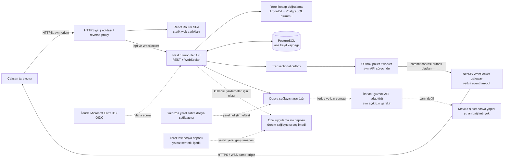

# ENCEV PULSE — Teknik Mimari Önerisi

**Durum:** Mimari referans; yerel kullanıcı girişi ve auth şeması uygulanmıştır. Diğer iş modülleri tasarım aşamasındadır.
**Öncelik:** `AGENTS.md` ve [Veri Koruma Politikası](DATA_PROTECTION_POLICY.md) bu tasarımın üstündedir.

## 1. Mimari hedef ve öneri

ENCEV PULSE için önerim, tek kod tabanında sınırları belirgin bir **modüler monolit** ve küçük sayıda dağıtım bileşenidir:

- **Web arayüzü:** React + React Router Framework Mode, SPA çıktısı ve Vite derleme.
- **Backend:** TypeScript/NestJS ile modüler API; sohbetin şu anki canlı güncellemesi same-origin SSE ve PostgreSQL `LISTEN/NOTIFY` ile çalışır. WebSocket etkin değildir; ihtiyaç doğrulanırsa sonraki seçenek olarak değerlendirilir.
- **Veri:** PostgreSQL; erişim yalnızca backend üzerinden.
- **Veri erişimi:** Drizzle ORM ve incelemeye açık SQL migration dosyaları.
- **Arka plan işleri:** İlk aşamada PostgreSQL transactional outbox ve aynı backend kodunu çalıştıran worker.
- **Kimlik:** İlk sürümde yönetici tarafından oluşturulan yerel hesaplar; giriş e-posta veya kullanıcı adı ile. Microsoft Entra ID / Microsoft 365 OIDC entegrasyonu sonraki aşama seçeneğidir, şu an etkin değildir.
- **Ortak Drive:** Şimdilik yalnızca adapter/API sözleşmesi tasarımı. Canlı sunucu bağlantısı, dosya okuma veya test yok.

Bu tasarım, görev ve proje akışını hızlı sunarken sohbeti, bildirimleri ve yasal süreçleri aynı kimlik, izin ve kayıt ilkelerine bağlar. Mikroservis, Kubernetes, Redis ve ayrı arama kümesi başlangıç mimarisine eklenmez. Ölçülen ihtiyaç doğarsa daha sonra eklenebilir.

## 2. Sistem diyagramı

**Önemli:** Diyagramdaki şirket dosya depolaması erişilebilir bir uç nokta değildir. Şu aşamada bağlantı kurulmayacak; test verisi yalnızca yerel sahte sağlayıcıdan gelir. Uygulama eki deposu da ayrıca karara bağlanması gereken bir seçenektir.

## 3. Katmanlar ve sorumluluklar

### Web istemcisi

- Genel Bakış, Kanban/liste, proje ve üç panelli sohbet ekranlarını üretir.
- Görüntüleme tercihi, form doğrulama ve anlık kullanıcı etkileşimini yönetir.
- Yetki kararı vermez; API'nin reddettiği kaydı önbellekten veya WebSocket olayından göstermemelidir.
- Büyük listelerde sunucu tarafı sayfalama/filtreleme ve sanallaştırma kullanır. İstemci tüm görevleri indirmez.
- REST yanıtları kalıcı kaynaktır. İyimser güncellemeler başarısız olursa geri alınır; sohbet mesajı gönderildi onayı sunucudan gelmeden başarı gösterilmez.

### Backend modülleri

NestJS içinde modül sınırları iş alanlarına göre kurulur; örneğin:

- `Identity & Access`: kullanıcı eşlemesi, roller, ekip ve proje üyeliği.
- `Tasks & Projects`: görevler, durum geçmişi ve proje ilişkileri.
- `Chat`: konuşmalar, üyelik, mesajlar, yanıtlar, reaksiyonlar, okundu imleçleri ve ek metadata'sı.
- `Notifications`: uygulama içi bildirimler ve tercihleri.
- `Calendar & Legal Rules`: tarih kuralları ve süreç tarihleri.
- `Institutions & Processes`: kurum rehberi, kurum görüşleri ve e-ÇED kayıtları.
- `Documents`: dosya metadata'sı ve sağlayıcı arayüzü; ilk aşamada yalnızca yerel sahte sağlayıcı.
- `Audit`: değiştirilemeyen işlem olayları.

Modüller başka modüllerin tablolarını doğrudan değiştirmez; açık servis/API sınırlarından geçer. HTTP ve SSE aynı session ve kaynak üyeliği denetimlerini kullanır. NestJS modülleri ve SSE yanıtlarını Observable üzerinden sunma desteği modül sınırını korur: [NestJS Modules](https://docs.nestjs.com/modules), [NestJS Server-Sent Events](https://docs.nestjs.com/techniques/server-sent-events).

### API yaklaşımı

- JSON REST API. Şu anki uygulama yolları `/api/*` altındadır; dış sözleşme sabitlenmeden önce sürümleme politikası karara bağlanacaktır. Üretim modülleri için OpenAPI sözleşmesi hazırlanır.
- Sohbet canlı güncellemeleri SSE üzerinden, tek yönlü ve içerik taşımayan invalidation sinyalleriyle iletilir. Mesaj gönderme, okuma ve diğer değişiklik komutları REST üzerinden yürür; SSE koparsa istemci sınırlı aralıklı REST yenilemesine döner. WebSocket mevcut uygulamada etkin değildir.
- Liste uçları filtre, sıralama ve cursor/limit kabul eder; her alan sunucu tarafında izinli alan listesinden doğrulanır.
- Her değişiklikte `request_id`, actor, zaman ve gerekliyse idempotency anahtarı tutulur.
- API hata yanıtları sabit `code`, kullanıcıya uygun mesaj ve korelasyon kimliği döndürür; stack trace veya gizli veri döndürmez.
- İstemciden gelen `user_id`, `team_id`, `project_id` gibi değerler yetki kanıtı sayılmaz; backend üyelik ve kapsamı veritabanından doğrular.

İlk uygulama diliminde `TasksModule`, `projects`, `project_members`, `tasks`, eklemeli `task_audit_events` ve `notifications` tablolarını kullanır. Görev erişimi oluşturan/atanan kullanıcı veya proje üyeliğine dayanır; proje görevi için aktör ve atanan kişi üye olmalıdır. Güncelleme `version` ile iyimser eşzamanlılık kontrolü yapar. Liste API'si filtreleri allowlist'le doğrular, sayfa boyutunu sınırlar ve arşiv dışı sonuçları varsayılan verir. Atama bildirimi görev transaction'ında kalıcılaşır; Genel Bakış aktivitesi erişilebilir görevlerin audit kayıtlarından okunur. Bu aşamada yorum, takipçi ve görev dosyası işlevleri henüz açılmamıştır.

### Kimlik doğrulama ve oturum

- **Yerel hesap modeli:** Kullanıcıyı sistem yöneticisi oluşturur; herkese açık kayıt yoktur. Kullanıcı adı ve `@encev.com.tr` e-posta adresi aynı hesaba ve aynı parolaya bağlanır. Giriş alanı “E-posta veya kullanıcı adı” kabul eder. Kullanıcı adı/e-posta girişi trim edilir ve küçük harfe normalize edilerek DB'deki benzersiz kanonik değerlerle eşleştirilir.
- **Parola:** Parola Node.js'in yerleşik Argon2id uygulamasıyla, kullanıcı başına rastgele salt ve başlangıçta `m=19456 KiB, t=2, p=1` parametreleriyle hash edilir; PHC biçiminde algoritma/sürüm/parametre bilgisi saklanır. Bu seçim OWASP minimumunu karşılar; üretim donanımında ölçülüp yeniden değerlendirilmelidir. API Node.js `>=24.7.0` ister. Düz parola, hash girdisi veya hassas doğrulama detayı loglanmaz.
- **Oturum:** Başarılı girişte kriptografik olarak rastgele opaque bearer değeri üretilir; yalnız SHA-256 özeti PostgreSQL `auth_sessions` satırında tutulur. Ham değer sadece cookie'ye yazılır. Sunucu her istekte kullanıcı durumu, iptal, mutlak ve hareketsizlik sona erme zamanını denetler. Uygulamadaki başlangıç varsayılanı 8 saat hareketsizlik ve 7 gün mutlak ömürdür; production süreleri kurum kararıyla onaylanmalıdır. Girişte session fixation önlemek için yeni oturum kimliği verilir; çıkış, parola yenileme, hesap devre dışı bırakma ve yönetici oturum iptalinde DB kaydı revoke edilir.
- **Cookie:** Üretimde `__Host-pulse_session; Secure; HttpOnly; SameSite=Lax; Path=/` kullanılır; `Domain` ayarlanmaz. Yalnız `127.0.0.1` geliştirme ortamında HTTPS zorunlu olmadığından ayrı `pulse_session` adı ve `Secure=false` geliştirme ayarı kullanılabilir; bu istisna üretim konfigürasyonunda başlatmayı engelleyen doğrulamayla kapatılır. Token `localStorage`/`sessionStorage` içine konmaz.
- **CSRF:** CSRF token, PostgreSQL'de oturuma bağlı hash ile doğrulanan synchronizer token'dır; tarayıcı token'ı yalnız bellekte tutup state-changing istekte özel header ile yollar. Giriş ve CSRF-token edinme uçları da strict `Origin` kontrolü ve tek kullanımlı/sona eren pre-auth CSRF challenge ile korunur. SameSite tek başına yeterli sayılmaz. Tüm cookie tabanlı değiştirici isteklerde token + `Origin` + içerik türü denetlenir.
- **Rate limit:** Giriş denemeleri IP ve normalize edilmiş kimlik bilgisi boyutlarında PostgreSQL üzerinde atomik sayaçlarla sınırlandırılır; sayaç anahtarları ham kimlik bilgisi olarak saklanmaz. Mevcut başlangıç değeri hesap başına 15 dakikada 5, IP başına 15 dakikada 30 istektir. Yanlış parola ile mevcut olmayan kullanıcı aynı genel hata biçimini verir. Bu eşikler production yükü ve güvenlik incelemesiyle ayarlanmalıdır; kalıcı hesap kilidi uygulanmaz.
- **Kullanıcı yönetimi:** Kullanıcı oluşturma, listeleme, parola yenileme ve devre dışı bırakma yalnız sistem yöneticisi yetkisiyle yapılır ve audit edilir. Yönetici parola yenilemesi tek kullanımlı, 24 saat geçerli geçici parola üretir; yalnız hash saklanır, kullanıcı ilk girişte parolasını değiştirir ve eski oturumlar iptal edilir. Son etkin sistem yöneticisinin hesabı devre dışı bırakılamaz. E-posta/SMTP olmadığı için parola sıfırlama e-postası veya çalışmayan bağlantı gösterilmez; geçici parola yöneticiye bir kez gösterilir ve kullanıcıya güvenli kanaldan iletilmelidir.
- **İlk yönetici:** Bir defalık yerel CLI, yalnız etkileşimli TTY'de gizli parola girişi alır; parola argüman/env/log içine konmaz. Tek transaction ve kilit altında yalnız hiç tamamlanmamış bootstrap durumunda yönetici hesabı oluşturup bootstrap'ı tamamlandı işaretler; önceden var olan yönetici varsa yeniden çalışmayı reddeder. Varsayılan hesap/parola yoktur. Komut migration sonrası ve yerel yönetici tarafından çalıştırılmalıdır.
- **Gelecekte SSO:** Entra ID / Microsoft 365 OIDC için `external_identities` gibi ayrı provider/issuer/tenant/subject eşlemesi kullanılabilir. E-posta eşitliğine dayanarak hesap otomatik birleştirilmez; bağlama doğrulanmış akışla yönetici onayı gerektirir. Şu an OIDC, sağlayıcı yapılandırması veya harici giriş akışı yoktur.
- **Yetkilendirme ve WebSocket:** Kimlik doğrulama, RBAC ve kayıt kapsamı kontrolünden ayrıdır. WebSocket handshake aynı session cookie'si ve izinli Origin ile doğrulanır; token URL/query string'e konmaz. Her bağlantı ve olayda session, hesap durumu, rol ve kaynak üyeliği kontrol edilir.

### Geliştirme ve üretimde origin

- **Yerel geliştirme:** React Router/Vite `127.0.0.1:5173`, NestJS API `127.0.0.1:3000` üzerinde dinler. Vite `/api/*` yollarını loopback API'ye proxy eder; gerçek auth uçları `/api/auth/*` altındadır ve tarayıcı same-origin çağrı yapar, CORS açılmaz. HTTP cookie istisnası yalnız yerel geliştirmede `pulse_session` adıyla kullanılabilir. Auth testleri yalnız rastgele sentetik test hesabı/verisiyle yapılır ve sonunda temizlenir; gerçek parola/şirket ağı kullanılmaz.
- **Üretim:** Reverse proxy aynı HTTPS hostunda statik SPA'yı ve `/api/*`, WebSocket yolunu NestJS'e yönlendirir. Cookie Secure ve host-only kalır; API'nin `TRUSTED_PROXY_IPS` allowlist'i yalnız proxy IP'lerinden gelen forwarded header'lara güvenmesini sağlar. Ayrı origin gerekli olursa CORS/cookie/CSRF tasarımı yeniden incelenir; credential'lı wildcard kullanılmaz.

## 4. Sohbet ve gerçek zamanlı akış

**Mevcut uygulama:** SSE (`/api/chat/events`) + PostgreSQL `LISTEN/NOTIFY`. Migration tetikleyicileri mesaj, üyelik, tepki, okundu imleci ve mesaj-görev bağlantısı değişikliklerinde yalnızca konuşma ID'si/olay türü gibi içeriksiz veriler yayımlar. API listener aktif konuşma üyelerini veritabanından tekrar bulur ve kullanıcı başına SSE kanallarına invalidation sinyali gönderir. Tarayıcı içerik taşıyan bir push mesajı almaz; seçili konuşmayı ve listeyi yetkili REST uçlarından yeniler. Oturum akışı 60 saniyede tekrar doğrulanır; SSE veya PostgreSQL listener kesilirse yeniden bağlanma ve 15 saniyelik yedek sorgulama devreye girer. Bu başlangıç çözümü tek API örneği varsayar.

1. İstemci command API'ye mesajı, `client_request_id` ile gönderir; unique constraint yinelenen komutu güvenli idempotent yanıta dönüştürür.
2. Tek PostgreSQL transaction'ında üyelik/yetki doğrulaması, mesaj, gerekiyorsa revision, audit kaydı ve `outbox_events` satırı yazılır. Commit başarısızsa WebSocket olayı yoktur.
3. Aynı başlangıç API sürecindeki outbox poller, commit edilmiş ve `available_at` zamanı gelmiş olayları kısa bir claim/lease transaction'ıyla alır (`FOR UPDATE SKIP LOCKED`); lease yenilenmezse başka poller tekrar deneyebilir. Olay gövdesi hassas mesaj metni yerine event ID ve gerekli opak kayıt kimliklerini taşır.
4. Dispatcher mesajı kalıcı kayıttan yükler, konuşma üyelerini ve erişimi doğrular, sonra o API örneğine bağlı ve yetkili WebSocket üyelerine gönderir. Başarılı publish sonrası outbox işaretlenir. Gönderim ile işaretleme arasında süreç çökerse tekrar gönderim olabilir; teslimat semantiği **at-least-once**'dır, exactly-once değildir. Event ID istemci dedup sağlar.
5. WebSocket bildirimi kalıcı kaynak değildir. İstemci son cursor'dan REST geçmişini tamamlar; dolayısıyla bağlantı kesintisi veya yinelenen olay mesaj kaybına dönüşmez. Sunucu ACK'i mesajın DB commit edildiğini gösterir, her alıcının ekranda gördüğünü garanti etmez.
6. Worker deneme sayısı, lease, `available_at`, exponential backoff ve kalıcı hata için dead-letter/operasyon alarmı kullanır. İşleyiciler idempotenttir; outbox satırları yalnız operasyon politikasıyla arşivlenir.

İlk aşamada API, WebSocket gateway ve poller aynı tek NestJS çalışma sürecindedir; ayrı mikroservis/Redis gerekmez. DB outbox, istemcinin bağlı olduğu farklı API örneklerine kendi başına fan-out sağlayamaz. Yatay API çoğaltma öncesinde ortak broker ya da başka paylaşımlı dağıtım katmanı kararı zorunludur. O zamana kadar tek API örneği kullanılır; ölçekleme ihtiyacı ölçümle doğrulanır.

## 5. İş kuyruğu, bildirim ve hata yaklaşımı

- Görev/mesaj/süreç transaction'ı ile oluşması gereken bildirim, `outbox_events` tablosuna aynı transaction'da yazılır. Tek süreçte poller, kısa lease'lerle olayları claim eder; yan etkiler idempotent işlenir.
- WebSocket publish DB commit sonrasında yapılır. Publish-ack çökmesi yinelenen teslimat üretebilir; event ID dedup ve DB cursor'dan yeniden eşitleme bunu güvenli kılar. Kaçırılan alıcıya dair kesin socket teslim garantisi verilmez.
- İlk aşamada PostgreSQL outbox/worker yeterlidir. E-posta, ağır dosya taraması veya yüksek hacimde ayrı kuyruk/broker ancak ölçüm ve gereksinim sonrası değerlendirilir. Redis veya mikroservis başlangıç gereksinimi değildir.
- Worker geçici hatalarda kademeli yeniden dener; kalıcı hatayı ölçülü dead-letter durumuna alır ve operasyon ekibine görünür kılar.
- E-posta ve harici bildirimler, uygulama içi bildirimin tek kopyası yerine teslimat kanallarıdır; teslim edilmediyse başarılı gösterilmez.
- API hata sınıfları: kullanıcı doğrulama hatası, yetki reddi, bulunamayan kayıt, çakışma/versiyon uyuşmazlığı, geçici bağımlılık hatası ve beklenmeyen iç hata.

## 6. Dosya sağlayıcı sınırı

Şirket dosya yapısı için varsa ayrı, pasif bir `DocumentProvider` mimari sınırı daha sonra değerlendirilebilir; gerçek provider, yol, IP, hesap, token veya sunucu yapılandırması oluşturulmaz. Geliştirme ve testte yalnız yerel sentetik provider kullanılır.

Sohbet ekleri bu şirket kaynağından tamamen bağımsız bir **uygulama deposuna** tasarlanır. Üretim sağlayıcısı henüz seçilmez ve hiçbir provider etkinleştirilmez. Yerel geliştirme/testte test içeriği sadece proje içindeki yerel dosya deposuna yazılacak şekilde tasarlanır; ağ tabanlı veya NAS fallback'i bulunmaz.

Upload akışı: DB'de `pending` attachment kaydı aç → boyut/tür/kullanıcı sınırını doğrula → uygulama deposuna üretilmiş opak object ID ile karantinaya yaz → içerik/MIME/zararlı yazılım kontrolleri tamamlanınca `ready` yap ve mesaj bağlantısını commit et. Depo ile PostgreSQL ortak transaction olmadığından yarım yük/metadata için idempotent reconciliation ve cleanup outbox olayı gerekir. Başarısız tarama `rejected` olur ve indirilemez.

Download API her istekte oturum, konuşma üyeliği ve attachment state'i doğrular; public kalıcı URL veya NAS yolu dönmez. İlk üretim seçeneğinde backend akış/proxy değerlendirilir; sağlayıcı belli olduktan sonra kısıtlı, kısa ömürlü imzalı URL değerlendirilebilir. Nesne private, şifreli ve uygulama tarafından yönetilir; dosya adı normalize edilir, response `Content-Disposition: attachment` ve `nosniff` ile sınırlandırılır. Kota, azami boyut/tür, antivirüs ve saklama süresi karara bağlanana kadar gerçek yükleme özelliği açılmaz.

Şu an gerçek provider, yol, IP, hesap, token veya sunucu yapılandırması oluşturulmayacaktır. Geliştirme/test sadece yerel sahte provider ile yapılır. Şirket dosya sunucusunun hangi API'yi sunduğu ve kullanıcı izinlerinin backend tarafından güvenle uygulanıp uygulanamayacağı, ileride kullanıcı açıkça izin vermeden doğrulanamaz. Kurallar [Veri Koruma Politikası](DATA_PROTECTION_POLICY.md) içinde bağlayıcıdır.

## 7. Yasal süre kuralı çalışma modeli

- Kural, çalıştırılabilir kod değil sürümlü ve şemayla doğrulanan veri tanımıdır: tanımlı tetikleyici olay kodu, gün türü (takvim/iş), pozitif süre, başlangıç dahil-hariç kuralı, hafta sonu/resmî tatil/son gün politikası, yerel bitiş saati, IANA saat dilimi, DST belirsizlik politikası ve onaylı tatil takvimi sürümü.
- Tanım yalnız allowlist enum/sayı/tarih alanlarından oluşur. SQL, JavaScript, ifade, template veya kullanıcı script'i eval edilmez. Bilinmeyen alan, saat dilimi veya politika reddedilir.
- Taslak sürüm doğrulanıp hash'lenir; onaylayan kişi yazarından farklı olmalıdır. Onay kaydı aynı definition hash'i ve takvim sürümünü kapsar. Onaylı sürüm değiştirilemez; değişiklik yeni sürüm ve yeni onay ister.
- Otomatik tarih hesaplama yalnız geçerli tarihte etkin olan onaylı sürümle yapılır. Uygun kural/tatil takvimi yoksa tarih üretmek yerine kayıt “kural onayı bekliyor” durumuna geçer. İsteğe bağlı taslak önizleme varsa açıkça bağlayıcı olmayan simülasyon olarak etiketlenir ve resmi due date alanına yazılmaz.
- Kural/tatil tanımı kanonik serileştirilip belirlenmiş hash algoritmasıyla (öneri: SHA-256) doğrulanır; onay hash'i tam olarak bu içeriğe bağlanır. Her hesap kaydı girdi snapshot'ı, kural sürümü/hash'i, holiday calendar sürüm/hash'i, timezone, hesaplama algoritması sürümü, yerel son gün ve UTC sonucu saklar. Yeniden hesaplama yeni kayıt ve gerekçe üretir; önceki sonuç değiştirilmez. Kurum/hukuk sahibi kuralın maddi doğruluğunu onaylamadıkça sistem tarihleri hukuki uygunluk iddiası oluşturmaz.

## 8. Audit kayıtlarının korunması

- İşlemin actor/action/target/önemli alan metadata'sı ile audit kaydı aynı PostgreSQL transaction'ında yazılır. Gerekli audit yazılamazsa korunması gereken iş değişikliği de rollback olur.
- Audit tablo ve şeması ayrı DB owner rolüne aittir. API ve worker runtime rolleri tablo sahibi olmaz; yalnız `INSERT` ve gereken sınırlı `SELECT` yetkileri bulunur. `UPDATE`, `DELETE`, `TRUNCATE`, DDL ve grant yetkileri verilmez. Audit trigger'ı UPDATE/DELETE girişimlerini reddeder; trigger ek savunmadır, yetki sınırının yerine geçmez.
- Audit satırları uygulama arayüzünden düzenlenemez/silinemez. Düzeltme gerekiyorsa eski satırı değiştirmek yerine yeni, ilişkilendirilmiş düzeltme olayı eklenir.
- Kayıt kimliği, actor, olay türü, zaman ve korelasyon bilgisi; değişiklik metadata'sı ise alan allowlist'iyle saklanır. Parola/token, mesaj gövdesi, dosya byte'ı veya gereksiz kişisel veri kaydedilmez.
- DB süper kullanıcı/altyapı yöneticisi teknik olarak ayrıcalıklıdır; bu tehdide karşı uygulama içi garanti verilemez. Bu roller çok sınırlı tutulmalı; admin erişimi kurumun ayrı, erişimi kısıtlı altyapı audit sisteminde izlenmelidir. Yedek/retention da audit kayıtlarını kapsar.

## 9. Ölçek ve performans

- Büyük görev tablosu: server-side filtre/pagination, uygun bileşik indeksler, TanStack Virtual ile görünen satırları sanallaştırma.
- Kanban: her sütunun sayısı/sayfası ayrı; sürükle-bırak sonucu optimistic update + API onayı; sıra değişimi tek transaction ve çakışma kontrolüyle yazılır.
- Chat: konuşma başına ters kronolojik cursor sayfalama; ilk ekran küçük son mesaj penceresini alır; ek dosya gövdeleri mesaj tablosuna yazılmaz.
- Dashboard: ana ekran sayfalı kayıt listeleri ve gerektiğinde önceden hesaplanmış özetler kullanır; bütün görev tablosunu tarayan canlı agregalar yazılmaz.
- İlk aşamada yatay ölçek yerine ölçüm, indeks ve sorgu profili. Read replica, Redis, arama servisi ve tablo partitioning yalnızca ölçülen darboğazda.

## 10. Dağıtım şekli

İlk üretim dağıtımı için öneri: statik web dosyaları, NestJS REST/WebSocket ve outbox poller aynı HTTPS reverse proxy arkasında; başlangıçta tek API örneği ve aynı API çalışma sürecindeki worker; PostgreSQL yalnız uygulama ağından erişilen (yönetilen hizmet kısa listede) özel DB olarak değerlendirilir. Kullanıcı sayısı, veri lokasyonu, KVKK incelemesi, işletme desteği ve bütçe bilinmeden bulut sağlayıcısı seçilmez. Same-origin ve cookie akışının ayrıntısı yukarıdaki geliştirme/üretim bölümündedir.

Kullanıcılar ev/ofisten yalnızca HTTPS uygulamasına bağlanır. Veritabanı internete açılmaz. Şirket dosya sunucusuna SMB/VPN tüneli veya doğrudan ağ yolu açılması önerilmez; gelecekteki entegrasyon güvenli backend/API tasarımı ve ayrı açık izin gerektirir.

## 11. Ürün aşamalarıyla mimari uyum

Mimari bileşenler erken tasarlanır; bu, tüm modüllerin ilk sürümde açılacağı anlamına gelmez:

1. **Temel platform:** kullanıcı/ekip/rol, kişisel ana ekran, Kanban ve liste görevleri, temel proje ilişkisi, uygulama içi bildirimler ve tema. Ortak API, PostgreSQL, audit ve yetki modeli bu akışlara hizmet eder.
2. **Erken ekip işbirliği:** kalıcı mesajlaşma ve gerçek zamanlı dağıtım, yanıt/reaksiyon/düzenleme-silme/okundu, ekler, arama ve mesajdan görev. Dosya modülü bu aşamada yalnızca sözleşme ve yerel sahte provider ile ele alınır.
3. **Yasal operasyon:** takvim ve sürümlü kural motoru, kurum dışı rehberi, Kurum Görüşleri ve e-ÇED akışları. Kural içeriği ve tatil kaynağı yetkili süreç sahiplerince onaylanır.
4. **Belge üretimi ve ileri işlevler:** Dilekçe Word üretimi, Notlarım ve doğrulanmış ihtiyaçlara bağlı gelişmiş yönetim/raporlama. Sesli/görüntülü görüşme ancak sonraki ayrı ihtiyaç ve altyapı kararıyla.

Bu sıralama [ürün vizyonundaki aşamalarla](PRODUCT_VISION.md#önerilen-geliştirme-aşamaları) uyumludur. Modül yalnızca gerçek akış ve kabul kriterleri tamamlandığında kullanıcıya açılır.

## 12. Teknoloji ve kaynak dayanakları

- React yeni uygulamalarda framework yaklaşımını öneriyor; React Router Framework Mode Vite ile SPA/SSR/static seçenekleri sunuyor. İç çalışma platformu için ilk öneri SPA: [React app oluşturma yaklaşımı](https://react.dev/learn/creating-a-react-app), [React Router modları](https://reactrouter.com/start/modes), [React Router SPA modu](https://reactrouter.com/how-to/spa).
- Next.js de geçerli bir seçenek ve self-host edilebilir; fakat ayrıca bir Nest API varken sunucu tarafı özelliklerin önemli bölümü iki sunucu katmanı yaratır. Self-hosting resmi rehberi reverse proxy ve çoklu örneklerde paylaşımlı cache koordinasyonunu ayrıca ele alıyor: [Next.js self-hosting](https://nextjs.org/docs/app/guides/self-hosting).
- PostgreSQL'in güncel resmi dokümanı 18 sürümünü desteklenen sürümler arasında gösterir; yedekleme için SQL dump, fiziksel yedek ve WAL/PITR yaklaşımlarını ayırır: [PostgreSQL 18 Backup and Restore](https://www.postgresql.org/docs/18/backup.html).
- İş ve teknoloji karşılaştırması [TECH_STACK_COMPARISON.md](TECH_STACK_COMPARISON.md), veri yapısı [DATABASE_DESIGN.md](DATABASE_DESIGN.md), dağıtım/güvenlik [SECURITY_AND_DEPLOYMENT.md](SECURITY_AND_DEPLOYMENT.md) içindedir.
